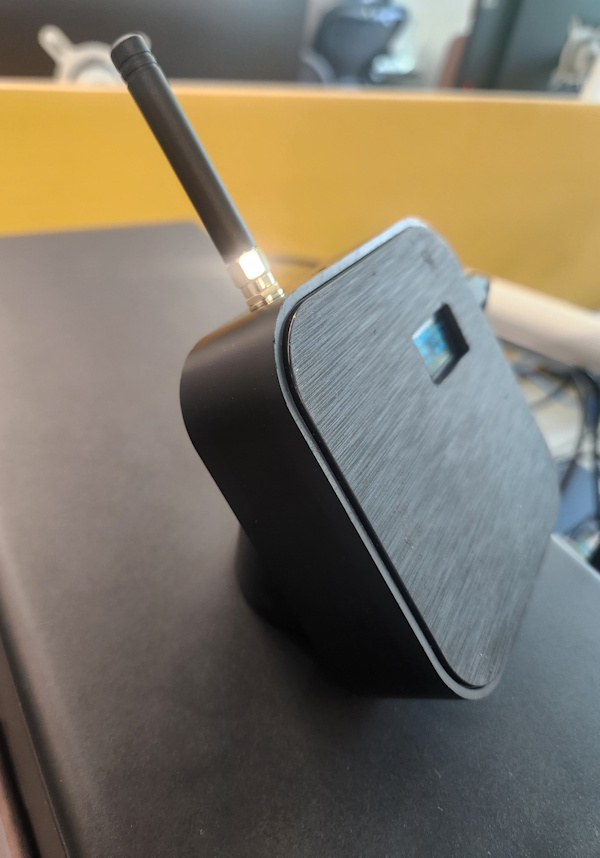
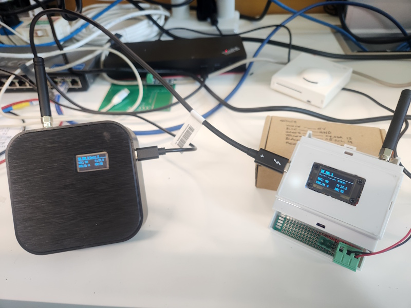

# ESP32 LoRa Sensor Transmitter

Wireless sensor transmitter based on the **Heltec WiFi LoRa 32 V4 (SX1262)**. It supports the Sensirion SEN54 environmental sensor and a Modbus RTU analog sensor over an external RS-485 transceiver.

This project is the transmitter side of the **LoRa BACnet Gateway** located here:

https://github.com/MGuerrero31416/LoRa-BACnet-Gateway

The selected sensor's measurements are sent over LoRa to the gateway, which exposes them through **BACnet MS/TP** for building automation integration such as Johnson Controls Metasys.

## Sensor Selection

Choose **Sensor type** in ESP-IDF menuconfig (`idf.py menuconfig`). The default is **SEN54**; select **Modbus RTU** to use an RS-485 analog sensor. Rebuild after changing the choice. Only the selected sensor is initialized or read.

SEN54 uses Device ID `1` and sends temperature, humidity, PM2.5, and VOC in their original packet fields. Modbus uses Device ID `2` and sends its analog register value in the packet's VOC field; temperature, humidity, and PM2.5 are set to `-1.0`. Use the matching Device ID and sensor selection expected by the gateway. Both selections retain the 26-byte packet format and 10-second transmission interval.

## Hardware Photos





## System Architecture

```text
SEN54 (I2C) ──┐
              ├──> ESP32-S3 + SX1262 ──LoRa──> LoRa BACnet Gateway
Modbus RTU ───┘                                      |
 (RS-485)                                            | RS-485 / BACnet MS/TP
                                                     v
                                               Building Automation System
```

Select only one sensor. SEN54 uses I2C1 on GPIO4 (SDA) and GPIO6 (SCL); Modbus uses UART1 on GPIO4 (TX) and GPIO6 (RX), so those interfaces share pins.

## Related Project

The corresponding receiving gateway is the [LoRa BACnet Gateway](https://github.com/MGuerrero31416/LoRa-BACnet-Gateway). It decodes the transmitter's packet and exposes the received values through BACnet MS/TP.

## Modbus RTU / RS-485 Wiring

When **Modbus RTU** is selected, the Modbus master uses UART1 and an external RS-485 transceiver:

- ESP32 TX: `GPIO4` to transceiver DI
- ESP32 RX: `GPIO6` from transceiver RO
- UART RTS: `GPIO5` connected to both transceiver DE and active-low `/RE`
- Transceiver A/B: to the Modbus device's RS-485 pair; connect grounds

GPIO4, GPIO5, and GPIO6 are exposed on Heltec V4.2.0 header J3 pins 15, 16, and 17 respectively. GPIO5 is not used by the firmware's LoRa or OLED mappings and is configured as the hardware UART RTS direction signal. The ESP-Modbus RTU master sets UART1 to hardware half-duplex mode; no GPIO direction-control task is used.

Modbus settings are grouped at the top of [main/modbus_sensor.c](main/modbus_sensor.c): unit ID `1`, input register function `0x04`, zero-based register address `0`, 9600 baud, 8N1, and scale `1.0` with offset `0.0`. Change these to match the connected device. The default measurement is an unsigned 16-bit register value converted as `raw * scale + offset`.

## OLED GPIO / I2C Wiring

The SSD1306 OLED uses a separate I2C bus:

- Display: SSD1306 128x64
- I2C bus: `I2C_NUM_0`
- SDA GPIO: `GPIO17`
- SCL GPIO: `GPIO18`
- I2C address: `0x3C`
- Clock speed: `400000 Hz`
- Reset GPIO: `GPIO21`
- Power-enable GPIO: `GPIO36`

## LoRa Packet

The transmitter sends a fixed 26-byte packet. All multi-byte values use little-endian byte order, and floating-point values use the ESP32's 32-bit IEEE-754 representation.

| Offset | Size | Field | Encoding |
| ---: | ---: | --- | --- |
| 0 | 1 | Protocol version | `uint8_t` |
| 1 | 4 | Device ID | `uint32_t`, little-endian |
| 5 | 4 | Sequence number | `uint32_t`, little-endian |
| 9 | 4 | Temperature (SEN54) / unavailable (`-1.0`, Modbus) | 32-bit float, little-endian |
| 13 | 4 | Relative humidity (SEN54) / unavailable (`-1.0`, Modbus) | 32-bit float, little-endian |
| 17 | 4 | PM2.5 (SEN54) / unavailable (`-1.0`, Modbus) | 32-bit float, little-endian |
| 21 | 4 | VOC index (SEN54) / analog measurement (Modbus) | 32-bit float, little-endian |
| 25 | 1 | Status | Bit 0 is the boot flag |

With SEN54 selected (Device ID `1`), offsets 9, 13, 17, and 21 contain temperature, relative humidity, PM2.5, and VOC respectively. With Modbus RTU selected (Device ID `2`), offset 21 contains the converted analog register value (`raw * scale + offset`); the other three float fields are `-1.0`. If Modbus initialization or a register read fails, the value at offset 21 is also `-1.0`, and the transmitter sends the packet and retries on its normal cycle. A failed SEN54 read is logged and that cycle is skipped rather than transmitting a packet.

The first successfully transmitted packet after startup has the boot flag set. Sequence numbers increment after successful transmissions.

## Hardware

- Heltec WiFi LoRa 32 V4
- ESP32-S3
- SX1262 LoRa transceiver
- SEN54 environmental sensor OR Modbus RTU analog sensor and RS-485 transceiver
- SSD1306 128×64 OLED

## User Settings

Choose the sensor with `idf.py menuconfig`, then build with `idf.py build`. The `sdkconfig` file stores the selection for the local build. Flash only after confirming the sensor selection, wiring, and gateway configuration.

- Firmware revision and date: `FIRMWARE_REVISION` and `FIRMWARE_DATE` in [main/main.c](main/main.c).
- Sensor selection and Device ID: choose the sensor in menuconfig. SEN54 uses ID `1`; Modbus RTU uses ID `2`.
- Transmission interval: `TRANSMIT_PERIOD_MS` in [main/main.c](main/main.c), in milliseconds.
- LoRa frequency and transmit power: `LORA_FREQUENCY_HZ` and `LORA_TX_POWER_DBM` in [main/lora_sx1262.h](main/lora_sx1262.h). The gateway and regional radio configuration must use a compatible frequency.
- LoRa modulation: `LORA_BANDWIDTH`, `LORA_SPREADING_FACTOR`, `LORA_CODING_RATE`, and `LORA_PREAMBLE_LENGTH` in [main/lora_sx1262.h](main/lora_sx1262.h). These settings must match the gateway.
- Packet format: `TELEMETRY_PACKET_VERSION` and `TELEMETRY_PACKET_LEN` in [main/telemetry_packet.h](main/telemetry_packet.h). Changes require corresponding gateway updates.
- OLED I2C address and speed: `OLED_ADDRESS` and `OLED_I2C_FREQUENCY_HZ` in [main/display.h](main/display.h).

Hardware pin mappings are defined in [main/lora_sx1262.c](main/lora_sx1262.c), [main/modbus_sensor.c](main/modbus_sensor.c), and [main/display.c](main/display.c).

## Development Status

The Modbus RTU transmitter and BACnet gateway have been tested as a complete wireless link. SEN54 support preserves the original sensor acquisition and telemetry path. Both modes use the same 26-byte packet format and 10-second transmission interval; their sensor values and unavailable-measurement behavior differ as described above.